# MistTerm User Manual

> **Version**: 1.1.2
> **Updated**: 2026-09-03
> **Website**: [mistlab.dev](https://mistlab.dev) · **Download**: [GitHub Releases](https://github.com/mistlab-dev/MistTerm/releases)

This manual is for users who use MistTerm to connect to servers, work in terminals, and transfer files. It does not cover compiling source code or development; for developer docs, see the `docs/` directory in the repository.

---

## Table of Contents

1. [What is MistTerm](#1-what-is-mistterm)
2. [Installation & Startup](#2-installation--startup)
3. [Quick Start in Five Minutes](#3-quick-start-in-five-minutes)
4. [Interface Overview](#4-interface-overview)
5. [Connecting to Servers](#5-connecting-to-servers)
6. [Using the Terminal](#6-using-the-terminal)
7. [Transferring Files](#7-transferring-files)
8. [Command Snippets](#8-command-snippets)
9. [Monitoring & Port Forwarding](#9-monitoring--port-forwarding)
10. [AI Assistant](#10-ai-assistant)
11. [Team & Sync (Optional)](#11-team--sync-optional)
12. [Command Safety Alerts](#12-command-safety-alerts)
13. [Credentials, Logs & Preferences](#13-credentials-logs--preferences)
14. [Keyboard Shortcuts](#14-keyboard-shortcuts)
15. [FAQ](#15-faq)

---

## 1. What is MistTerm

MistTerm is an **SSH terminal client** that helps you:

- Save multiple server connections and open terminals with one click
- Upload and download files via a graphical interface (SFTP)
- Save frequently used command templates (snippets) to avoid repetitive typing
- Monitor server CPU, memory, disk, and more
- Optional: AI-assisted command explanation, team-shared snippets

Supports **Windows** and **macOS**.

---

## 2. Installation & Startup

### 2.1 Download & Install

1. Go to [GitHub Releases](https://github.com/mistlab-dev/MistTerm/releases)
2. Download the installer for your system:
   - **Windows**: `MistTerm-*-windows-x86_64-setup.exe`, double-click to install
   - **macOS**: `.dmg`, drag into the Applications folder
3. Launch **Mist** (or MistTerm) from the Start menu / Launchpad

No separate OpenSSH installation is required; you can connect to remote Linux servers right away.

### 2.2 First Launch

On startup, the main window appears: the left side shows the **session list**, the center is the **workspace** (terminal appears after connecting), the top has the **menu bar**, and the bottom has the **status bar**.

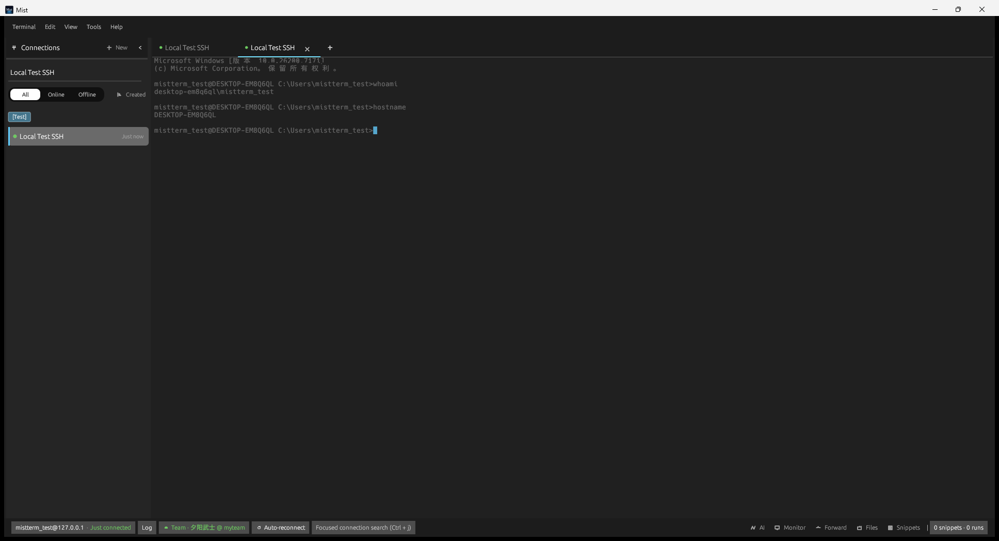

*Fig 2-1: Main interface with an active SSH connection*

### 2.3 Where Data Is Stored

Connections, passwords, snippets, and other configuration are stored locally in your user directory (encrypted), for example:

- Windows: `%APPDATA%\mistterm\`
- macOS: `~/Library/Application Support/mistterm/`

Do not edit these files manually; use the in-app interface to make changes.

---

## 3. Quick Start in Five Minutes

| Step | Action |
|------|--------|
| 1 | Press **Ctrl+N** (Mac: **⌘N**) to open "New Session" |
| 2 | Fill in name, host IP/domain, port (default 22), username, password or key |
| 3 | Click **Save & Connect**, or **double-click** the session in the sidebar |
| 4 | Type commands in the terminal, e.g. `ls`, `cd`, `top` |
| 5 | To transfer files: menu **View → SFTP**, or click **Files** in the bottom bar |

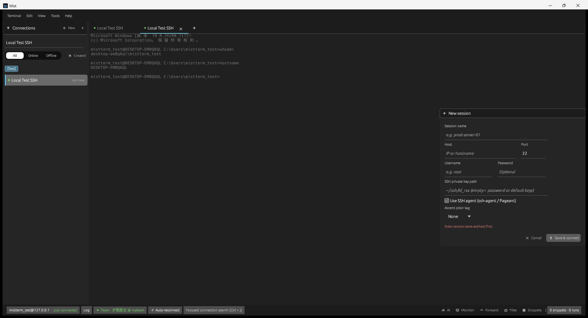

*Fig 3-1: New Session*

---

## 4. Interface Overview

### 4.1 Layout

| Area | Location | Description |
|------|----------|-------------|
| Top menu bar | Top of window | **Terminal**, **Edit**, **View**, **Tools**, **Help** |
| Session list | Left sidebar | Saved connections, supports grouping and search |
| Workspace | Center | Terminal tabs; type commands here after connecting |
| Side panels | Right (on demand) | SFTP, Monitor, Snippets, AI, etc. |
| Status bar | Bottom of window | Connection info and quick access: **AI** / **Monitor** / **Forward** / **Files** / **Snippets** |

### 4.2 Common Actions

| What you want | How to open |
|----------------|-------------|
| New/Edit connection | **Ctrl+N** / select in sidebar then **Ctrl+E** |
| Open SFTP | **View → SFTP** or bottom bar **Files** |
| View CPU/Memory | **View → Monitor** or bottom bar **Monitor** |
| Command palette | **Ctrl+K** when the terminal is not focused (Mac: **⌘K**). Fuzzy-search sessions, snippets, history, and app actions |
| Command snippets | Bottom bar **Snippets**, or type a snippet name in the command palette |
| AI Assistant | **Ctrl+Shift+A** or bottom bar **AI** |
| Preferences | **Ctrl+,** |
| Help & shortcuts | **Help → Quick Start / Keyboard Shortcuts** or **Ctrl+H** |

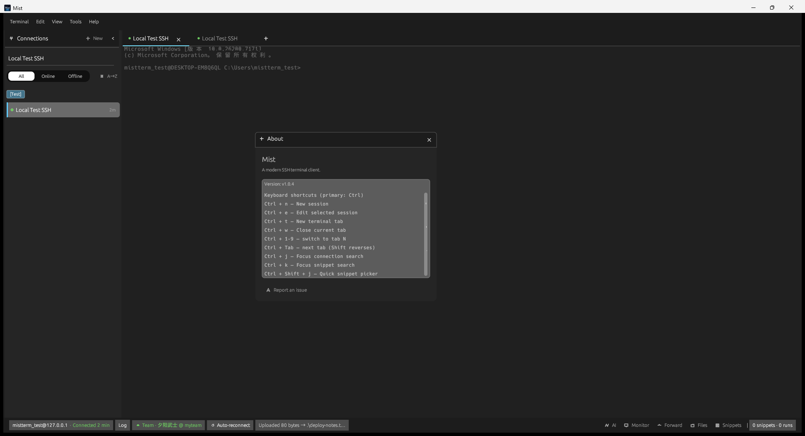

*Fig 4-1: Sidebar session list (groupable, searchable)*

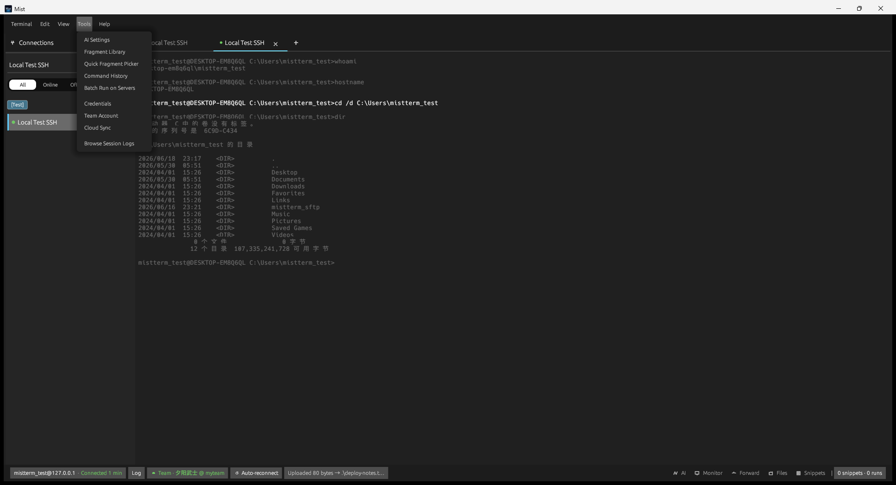

*Fig 4-2: View menu — toggle side panels*

### 4.3 Command palette

When the terminal is **not** focused, **Ctrl+K** (macOS: **⌘K**) opens the command palette. Type to fuzzy-search and run:

- **Sessions**: focus an open tab, or connect if none is open
- **Snippets**: same as the quick snippet picker — choosing one runs it (variables are filled in first)
- **Command history**: fill the command into the terminal input without pressing Enter
- **App actions**: open SFTP, Monitor, AI, port forwarding, Preferences, the command history window, a new session, and similar menu actions

Keys: type to filter, Up/Down to move, Enter to run, Esc to close. While the panel is open, keystrokes are not sent to the terminal.

**Why not Ctrl+Shift+K:** unfocused Ctrl+K / ⌘K does not conflict with the OS, so Windows and Linux keep Ctrl+K and macOS keeps ⌘K. When the terminal is focused, Ctrl+K is still sent to the shell and deletes to the end of the line (readline kill-to-EOL). The palette does not take that key.

The quick snippet picker is still **Ctrl+Shift+J**, and it also opens only when the terminal is not focused.

---

## 5. Connecting to Servers

### 5.1 Creating a New Session

1. **Ctrl+N** to open the dialog
2. Fill in:
   - **Session Name**: for easy identification, e.g. "Prod Web-01"
   - **Host**: IP or domain
   - **Port**: usually 22
   - **Username**
   - **Password** or **private key file path**
3. Optional: uncheck "Use SSH Agent" if using password-only login
4. Click **Save & Connect**

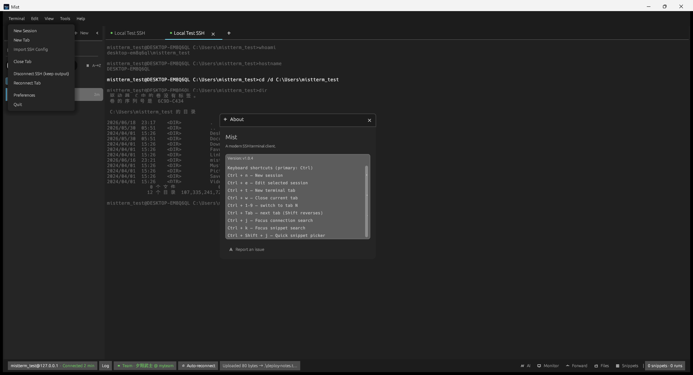

*Fig 5-1: You can also use **Terminal → Import SSH Config** to batch-import from an existing `~/.ssh/config`*

### 5.2 Authentication Methods

| Method | Use Case |
|--------|----------|
| Password | Server allows password login |
| Private key file | Local `.pem` / `id_ed25519`, etc. |
| SSH Agent | ssh-agent / Pageant running with key loaded |
| Jump host | Configure ProxyJump in advanced options (same as OpenSSH) |

### 5.3 Connecting & Reconnecting

- **Connect**: click a session in the sidebar → **Ctrl+T** for a new tab, or **double-click** the session
- **Search sessions**: **Ctrl+J** focuses the sidebar search box when the terminal is not focused (while it is focused, Ctrl+J goes to the shell)
- **Auto-reconnect**: enable KeepAlive / auto-reconnect in session settings
- The bottom bar shows `username@host · Connected` when successful

### 5.4 Local Data Security

Passwords and session info are **encrypted locally**. When switching computers, you need to reconfigure or restore from backup. Config files are in encrypted format — opening them in a text editor will show garbled characters, which is normal.

---

## 6. Using the Terminal

### 6.1 Basic Operations

- After connecting, type commands in the terminal area and press **Enter** to execute
- **Ctrl+C** always interrupts the foreground program (SIGINT), including when text is selected. Copy the selection with **Ctrl+Shift+C** on Windows/Linux, or **⌘C** on Mac. Paste with **Ctrl+Shift+V** (Mac: **⌘V**)
- **Ctrl+K** (terminal focused): sent to the shell; deletes to the end of the line. **Ctrl+J** (terminal focused): sent to the shell (line feed, same as readline). Connection search (Ctrl+J) and the command palette (Ctrl+K, Mac: ⌘K) run only when the terminal is not focused. Unfocused Ctrl+K does not conflict with the OS, so Ctrl+Shift+K is not used. The quick snippet picker is **Ctrl+Shift+J**, and it also opens only when the terminal is not focused
- **Alt** (macOS: **Option**) is Meta while the terminal is focused: **Alt+B** / **Alt+F** move by word, **Alt+D** / **Alt+Backspace** delete a word, and **Alt+.** inserts the last argument of the previous command (repeat to cycle earlier arguments). MistTerm UI shortcuts do not swallow these keys
- **Select across several screens**: click the start, scroll with the wheel to the end, then **Shift+click** to extend the selection. While drag-selecting, move the pointer past the top/bottom edge of the terminal to auto-scroll (faster the farther you go). Then right-click → Copy selection or **Ctrl+Shift+C** (Mac: **⌘C**) copies all of it
- **Chinese IME**: while composing, the preedit string is drawn at the cursor. The candidate list stays on the system IME panel. Ctrl chords such as Ctrl+C and Ctrl+R are still sent to the terminal during composition
- Supports colored output, vim, htop, and other common TUI programs
- Tabs: **Ctrl+T** for new tab; **Ctrl+W** to close current tab; **Ctrl+Tab** to switch tabs

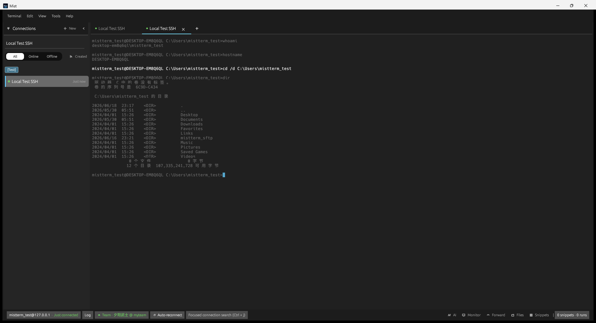

*Fig 6-1: Running commands in the terminal*

### 6.2 Find & History

- **F3** or **Ctrl+F**: search text in terminal output


*Fig 6-2: Find in terminal*

- **Ctrl+R** (terminal focused): sent to the shell as reverse-i-search. Mist does not open the command history panel
- **Tools → Command History**: open Mist's command history panel to search and re-run recent commands. When the terminal is not focused, **Ctrl+R** also opens that panel

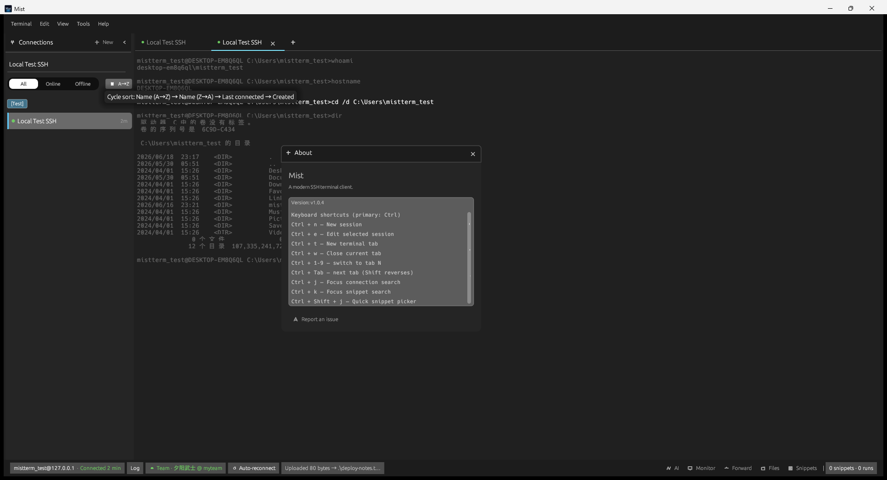

*Fig 6-3: Command history window*

### 6.3 Split Panes (Multiple Panes in One Tab)

The same commands are in the **Terminal** menu and the tab context menu.

Windows and Linux use **Ctrl+Shift**. macOS uses **⌘⇧**.

- **Ctrl+Shift+D** (macOS **⌘⇧D**): split left/right
- **Ctrl+Shift+U** (macOS **⌘⇧U**): split top/bottom
- **Ctrl+Shift+← / Ctrl+Shift+→**: move focus between panes (⌘⌥← / ⌘⌥→ on macOS)
- A new pane starts in the source pane's current directory (local shell, `cd` on Linux and macOS, PowerShell on a Windows remote)
- **Ctrl+Shift+B** (macOS **⌘⇧B**): **Broadcast input**. Keystrokes go to every pane in the tab. The pane header shows "Broadcast"

### 6.4 Known limitation: mouse and Alt+click

The mouse in the terminal is for **selecting text** and **scrolling**. The following are not implemented. They are limits of the product, not intermittent bugs:

- **Alt+click does not move the cursor** to the clicked cell (the shell line does not jump there)
- **MistTerm does not send the xterm mouse protocol to the PTY.** tmux and vim mouse modes therefore do not work: clicks and drags are not reported to the remote program

---

## 7. Transferring Files

### 7.1 SFTP Panel (Recommended)

**Open via**: menu **View → SFTP**, or bottom bar **Files**.

The interface has two panes — **Local** and **Remote**:

1. Use the path input at the top to navigate directories (press Enter to go)
2. Click to select files or folders
3. Use toolbar buttons or right-click menu: **Upload**, **Download**, **Delete**, **New Folder**, **Rename**
4. Results are shown in the **bottom status bar**

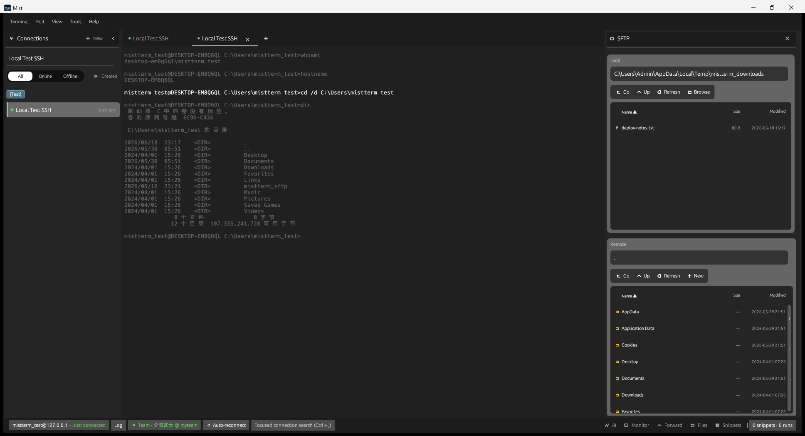

*Fig 7-1: SFTP dual-pane file management*

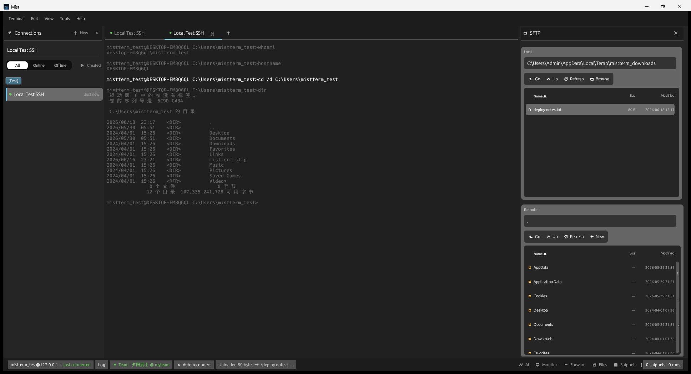

*Fig 7-2: Bottom bar confirmation after upload*

**Typical workflow — uploading a file to a server:**

1. After connecting via SSH, open the SFTP panel
2. In the left local pane, navigate to the file you want to upload
3. In the right remote pane, navigate to the target directory
4. Select the local file → Upload

**Download** works in reverse: select a remote file → Download to the current local directory.

### 7.2 ZMODEM in Terminal (rz / sz)

If the server has `lrzsz` installed, you can use these commands in the terminal:

```bash
# Upload a file from local to the current remote directory (follow the prompt to select a file)
rz -bye

# Download a file from remote to local
sz filename
```

MistTerm will automatically handle the transfer and show progress. If transfers fail, make sure the remote side uses `rz -bye`, and check whether a firewall is interrupting long connections.

---

## 8. Command Snippets

Save frequently used commands as **snippets** for one-click insertion. Supports `<variable>` placeholders.

### 8.1 Opening Snippets

| Method | Description |
|--------|-------------|
| **Ctrl+K** | Open the command palette and run a snippet (only when the terminal is not focused; when it is, the key goes to the shell and deletes to the end of the line. Mac: **⌘K**) |
| **Ctrl+Shift+J** | Quick snippet selector (only when the terminal is not focused) |
| Bottom bar **Snippets** | Open the snippet side panel |
| **Tools → Snippet Library** | Manage, create, and edit snippets |

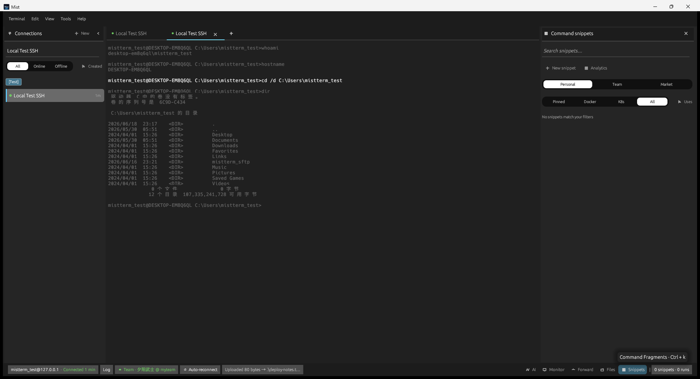

*Fig 8-1: Snippet panel opened from bottom bar*

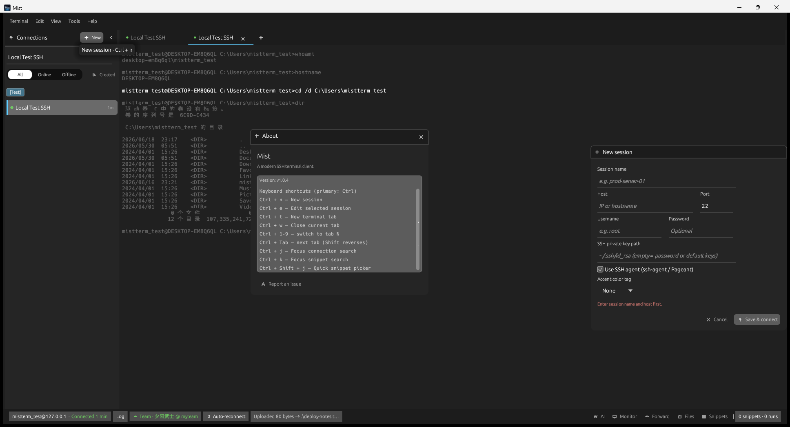

*Fig 8-2: Snippet Library — create and edit*

### 8.2 Using Variables

Example snippet content:

```bash
kubectl logs -f deployment/<service> -n <namespace>
```

When executed, an input dialog appears for each variable. After filling them in, the command is automatically substituted and sent to the terminal.

### 8.3 Team Snippets

If you are logged into a MistLab team account, you can use team-shared snippets (see Section 11).

Team snippets support **admin / editor / viewer** roles, with optional per-member overrides. Editing a team snippet acquires an edit lock and renews it automatically; after an abnormal exit, the client cleans up the current user's residual locks on the next startup or sign-in.

---

## 9. Monitoring & Port Forwarding

### 9.1 Host Monitoring

1. First establish an SSH connection
2. Open **View → Monitor** or bottom bar **Monitor**
3. View CPU, memory, disk, load charts (data is read-only, collected from the remote server)


*Fig 9-1: Host monitoring*

> Monitoring depends on the SSH connection. If the connection drops, charts stop updating; reconnect to resume.

### 9.2 Port Forwarding

1. Open bottom bar **Port Forward** or **View → Port Forwarding**
2. Add rules (format similar to OpenSSH):
   - **Local forward**: `local_port:target_host:target_port`
   - **Remote forward**: `remote_port:target_host:target_port`
   - **SOCKS proxy**: port number
3. Rules take effect when the session is connected


*Fig 9-2: Port forwarding management*

---

## 10. AI Assistant

### 10.1 Initial Configuration

1. **Tools → AI Settings** (or press **Ctrl+Shift+A** to open the panel first, then enter settings)
2. Fill in **API URL**, **API Key**, and **Model Name** (must be compatible with OpenAI-style API, such as various API gateways)
3. Save

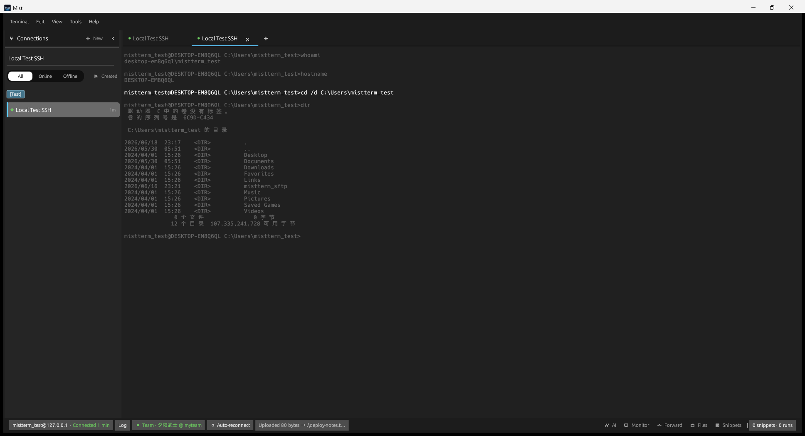

*Fig 10-1: AI Settings*

### 10.2 Usage

- **Ctrl+Shift+A** opens the AI panel; type your question and send
- **Ctrl+Shift+L**: send selected text from the terminal to AI for analysis
- Requests go directly to your configured API — **they do not pass through MistLab servers** (key is stored locally)

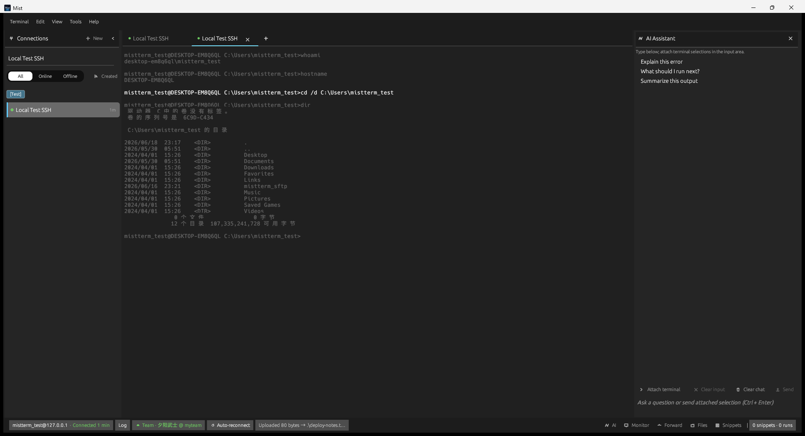

*Fig 10-2: AI assistant conversation*


*Fig 10-3: Tools menu — AI, Snippets, Batch Execute, Credentials, etc.*

---

## 11. Team & Sync (Optional)

For users of **MistLab Team Edition**:

1. **Tools → Team Account** to log in (browser OAuth authorization)
2. After logging in, you can:
   - Sync/share command snippets
   - View team audit records (if enabled by admin)
   - Use team Vault credentials (if configured)
   - View storage usage and command-audit Agent status in Team Settings
3. **Tools → Cloud Sync** can back up personal configuration to a Git repository (optional)

Without a team login, all personal features work normally.

### 11.1 Team snippets, editing, and storage

- **viewer** can view and use authorized team snippets.
- **editor** can create, edit, and maintain team snippets; the client renews the edit lock while editing.
- **admin** can manage team members, snippet permissions, and command-audit Agents.
- The Team Settings storage card shows total usage, quota, and category breakdown. If the API is unavailable, MistTerm shows a notice and local terminal use is unaffected.

### 11.2 Command-audit Agent status

When a team command-audit Agent is installed on the target server, MistTerm receives server-side audit results through the terminal connection. The Agent list in Team Settings shows the host, enabled state, and last heartbeat; administrators can enable or disable an Agent.

---

## 12. Command Safety Alerts

MistTerm has two layers of command safety checks: local checks provide fast feedback, while the server-side team policy is authoritative when an Agent is installed. Both can warn or block a dangerous command before it is sent or executed:

| Behavior | Description |
|----------|-------------|
| Block | Extremely high-risk commands like `rm -rf /` cannot be sent |
| Confirm | A dialog asks "Are you sure?" |
| Alert | Execution allowed but a warning is logged |

Local checks cover snippet runs, batch runs, commands inserted by AI, `mist exec`, and **commands you type directly in the terminal**: while a local policy is active, pressing Enter first checks the current line (including text placed by “Apply to terminal” and single-line pastes). A blocked line is not sent and stays on the prompt; a line that needs confirmation runs only after you click **Confirm send**. Typed commands are not checked locally (Enter is sent as usual) inside full-screen programs such as vim/less/top, on password or passphrase prompts, and during rz/sz transfers. Lines edited with arrow keys, Tab completion or shell history recall are checked only by the characters you actually typed; rely on the server-side policy for those.

View or adjust local rules in **Preferences**. When joining a team, admin-pushed policies sync to your machine. Server-side decisions are returned through the terminal connection and use the **“Server policy”** prefix.

### 12.1 Server-side blocks and compliant alternatives

When a server-side policy intercepts a command:

1. **Block**: MistTerm shows “Server policy: command blocked”; the original command is not sent.
2. **Confirm**: MistTerm shows a confirmation dialog; the command is sent only after choosing **Allow and send**.
3. **Alert**: execution is allowed and the team audit event is recorded.
4. If the team or personal snippet library contains a relevant safe operation, the intercept notice prioritizes a compliant alternative. It can be inserted into the current terminal, and a team suggestion can also be saved to the personal library.

Local rules use the **“Local check”** prefix. MistTerm does not use AI to explain how to bypass team policy; AI suggestions never replace server-side policy enforcement.

### 12.2 Agent unavailable

MistTerm periodically checks the current host's Agent heartbeat. If the Agent is offline or has not sent a heartbeat for about five minutes, a yellow notice appears at the top of the terminal. A recovery notification appears when it comes back. Local checks remain available, but server-side enforcement should be treated as unavailable until the team administrator fixes the Agent.

---

## 13. Credentials, Logs & Preferences

### 13.1 Credential Management

**Tools → Credentials**: centrally stores server accounts, database credentials, API tokens, etc., referenced by sessions or snippets. Encrypted locally by default.

### 13.2 Session Logs

Enable **Session Logging** in Preferences to automatically save terminal interaction records for later auditing. View via **Tools → Browse Session Logs**.

### 13.3 Preferences & Themes

- **Ctrl+,** opens Preferences: interface language, theme, font, audit, logging, etc.

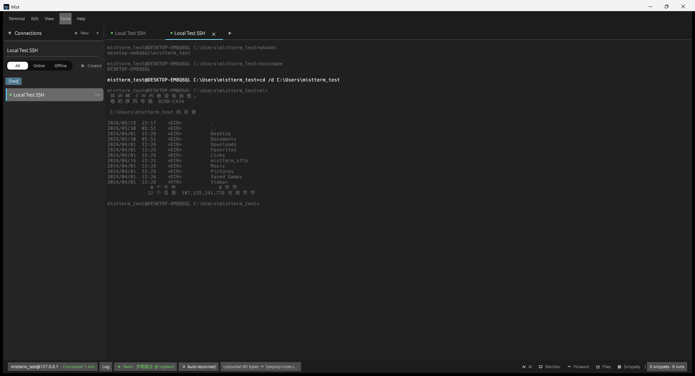

*Fig 13-1: Preferences*

- **Ctrl+H** to view About and built-in shortcut guide


*Fig 13-2: About Mist*

- **View → Theme**: switch between dark/light and other color schemes

### 13.4 Batch Execution

**Tools → Batch Execute**: select multiple saved hosts, enter a command, and execute it in parallel across all selected hosts. Useful for inspections (results are shown per host; overly long output is auto-truncated).

---

## 14. Keyboard Shortcuts

The following uses **Windows** keys; on macOS, replace **Ctrl** with **⌘** (e.g., Ctrl+N → ⌘N).

| Shortcut | Function |
|----------|----------|
| **Ctrl+N** | New session |
| **Ctrl+E** | Edit selected session |
| **Ctrl+Shift+T** | New terminal tab for selected session (Mac: **⌘T**) |
| **Ctrl+Shift+W** | Close current tab (Mac: **⌘W**) |
| **Ctrl+Tab** / **Ctrl+Shift+Tab** | Next / previous tab |
| **Ctrl+1 … Ctrl+9** | Switch to tab N |
| **Ctrl+J** | Focus connection search (only when the terminal is not focused; when it is, the key goes to the shell as a line feed) |
| **Ctrl+K** | Open the command palette (only when the terminal is not focused; search sessions, snippets, history, and actions. When focused, the key goes to the shell and deletes to the end of the line. Mac: **⌘K**. Ctrl+Shift+K is not used) |
| **Ctrl+Shift+J** | Quick snippet selector (only when the terminal is not focused) |
| **Ctrl+F** / **F3** | Find in terminal |
| **Ctrl+C** | Interrupt the foreground program (SIGINT), even with a selection. Copy with **Ctrl+Shift+C** (Mac: **⌘C**) |
| **Ctrl+Shift+V** (Mac: **⌘V**) | Paste into the terminal |
| **Ctrl+R** | When the terminal is focused, goes to the shell (reverse-i-search). When it is not, opens Mist command history. The panel is also under **Tools → Command History** |
| **Ctrl+Shift+A** | AI assistant panel |
| **Ctrl+Shift+L** | Send terminal selection to AI |
| **Ctrl+Shift+D** / **Ctrl+Shift+U** (Mac: **⌘⇧D** / **⌘⇧U**) | Split terminal left/right / top/bottom |
| **Ctrl+,** | Preferences |
| **Ctrl+H** | About & shortcut guide |
| **Alt+B** / **Alt+F** | While the terminal is focused, sent to the shell to move by word (Mac: **Option+B** / **Option+F**) |
| **Alt+D** / **Alt+Backspace** | While the terminal is focused, sent to the shell to delete a word forward / backward (Mac: **Option**) |
| **Alt+.** | While the terminal is focused, sent to the shell to insert the previous command's last argument (Mac: **Option+.**) |
| **Esc** | Close current dialog or menu |

For the complete list, refer to the in-app **Help → Keyboard Shortcuts**.


*Fig 14-1: In-app Help — Quick Start*

---

## 15. FAQ

### Cannot connect to server

- Check host, port, username, password/key
- Confirm your network can reach the target IP (try `ssh` from your system first)
- If a jump host is needed, configure ProxyJump in session advanced options
- Check the bottom bar for error messages

### Terminal is blank or shows garbled text after connecting

- Wait a few seconds for the shell to initialize
- Verify language and font in Preferences; Chinese environments generally auto-select an appropriate font

### SFTP cannot upload/download

- Confirm SSH is connected (same tab)
- Check write permissions on the remote directory
- Verify the local target path exists and is not read-only

### ZMODEM (rz/sz) transfer fails

- Confirm `lrzsz` is installed on the server (`which rz`)
- Use `rz -bye` for uploads
- Do not switch tabs or disconnect during transfer

### Config file appears as garbled text

- Normal behavior: MistTerm encrypts local configuration; modify settings only within the app

### How to uninstall

- **Windows**: Settings → Apps → MistTerm → Uninstall
- **macOS**: Drag MistTerm to Trash; configuration remains in `Application Support/mistterm/` and can be deleted manually

### How to report issues

Go to [GitHub Issues](https://github.com/mistlab-dev/MistTerm/issues) and describe the problem, version, and OS. Do not paste passwords or keys in issues.

---

*MistTerm v1.1.2 User Manual · MistLab*
